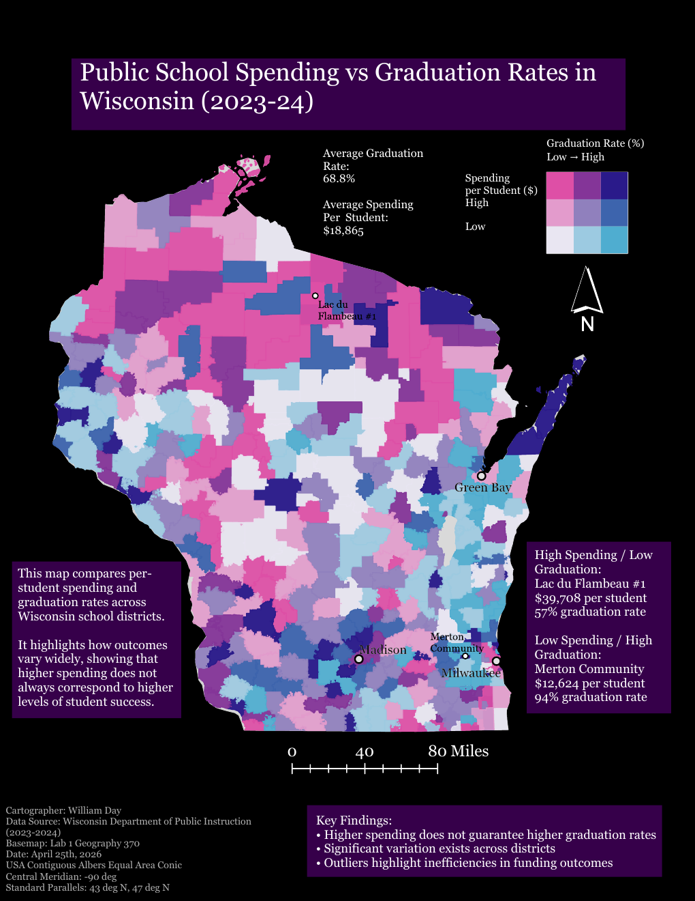

# Wisconsin Public School Spending vs. Graduation Rates (2023–24)



## The question

Do Wisconsin school districts that spend more per student also graduate more of their students? I wanted to see where spending and outcomes line up, and where they don't.

## Data

- **Spending and graduation rates:** Wisconsin Department of Public Instruction (DPI), 2023–24 school year, 421 districts
- **Basemap:** district boundaries from the GEOG 370 lab (UW–Madison)

## Method

1. Cleaned the DPI spending and graduation tables and joined them by district in Python and SQL.
2. Joined the combined table to the district boundaries in ArcGIS Pro.
3. Mapped both variables at once with a bivariate choropleth (spending per student on one axis, graduation rate on the other).
4. Projection: USA Contiguous Albers Equal Area Conic, central meridian -90°, standard parallels 43°N and 47°N, so district areas are not distorted.
5. Finished the layout (legend, callouts, text) in Adobe Illustrator.

## Key findings

- Statewide, the average graduation rate was **68.8%** and average spending was **$18,865 per student**.
- **Lac du Flambeau #1** spent **$39,708 per student** and had a **57%** graduation rate.
- **Merton Community** spent **$12,624 per student** and had a **94%** graduation rate.
- Higher spending doesn't guarantee higher graduation rates.
- There is a lot of variation from district to district, so the statewide averages hide a lot.

## Repo contents

```
map/
  wi_spending_vs_graduation.png   preview of the final map
  wi_spending_vs_graduation.pdf   full-resolution map (PDF)
README.md
.gitignore
```

## Coming soon

- The Python and SQL scripts I used to clean and join the data
- A link to an ArcGIS StoryMap version of this project

## About me

I'm William Day, a Data Science and Cartography & GIS student at UW–Madison. [LinkedIn](https://www.linkedin.com/in/william-day-5b73112bb)

---

Cartographer: William Day, April 2026
